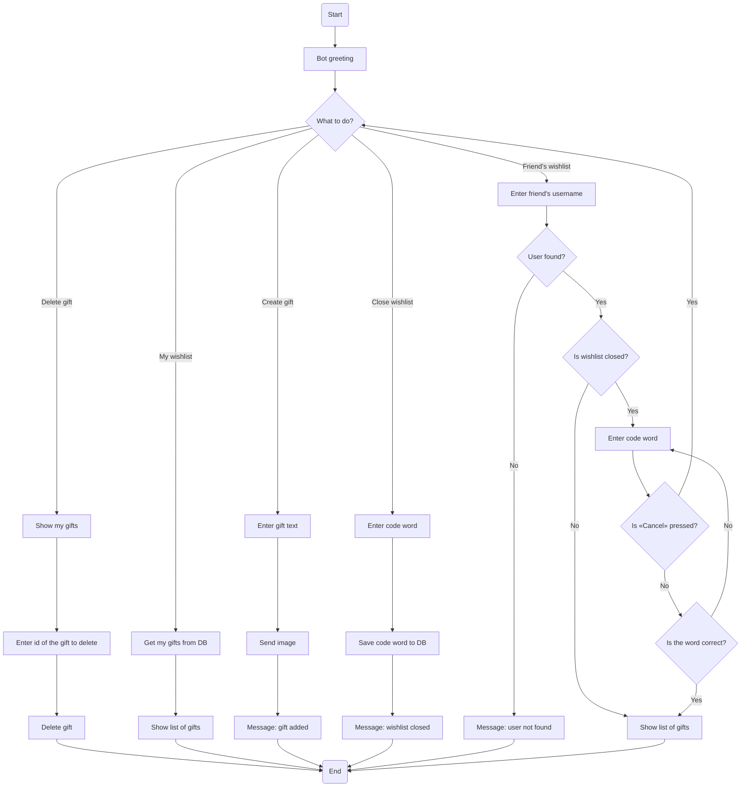

<h1>Wishlist Bot✨</h1>

<h3>Description</h3>

This bot was created so that everyone can leave their gift wishes in it and share them with their friends!

What distinguishes it from analogs is that the bot works entirely through messages in the messenger itself, without using a mini-app, which makes it easier to use.

<h3>How it works</h3>

To understand how the bot works, I created something like an activity diagram.

<h3>Stack</h3>
<ul>
  <li>python v3.13</li>
  <li>python-telegram-bot v22.5</li>
  <li>postgreSQL v18.6</li>
  <li>psycopg2</li>
</ul>