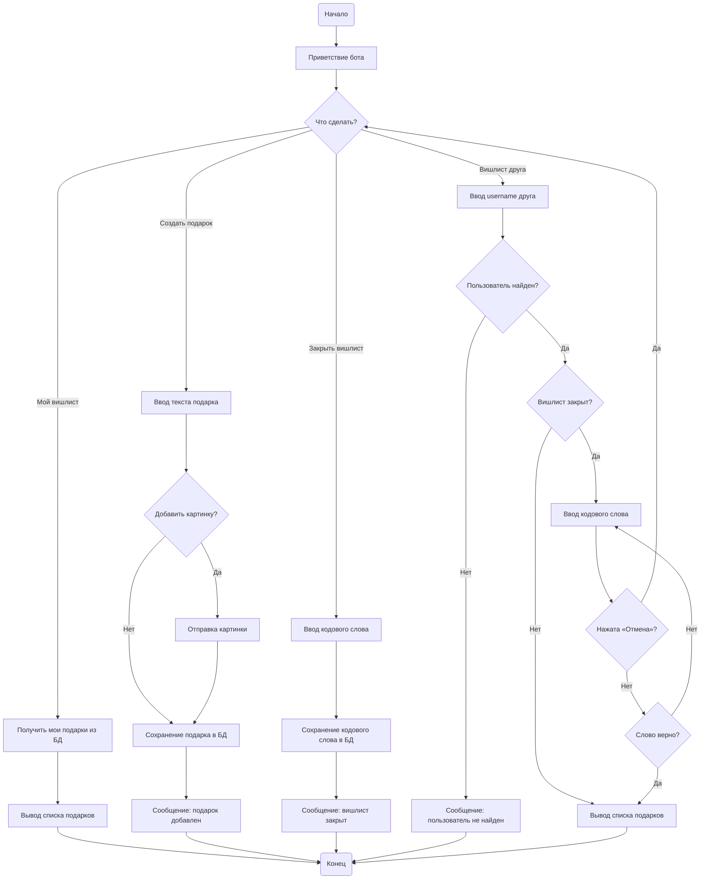

<h1>Бот желаний✨</h1>

<h3>Описание</h3>

Бот создан для того, чтобы каждый мог оставить в нем свои пожелания по поводу подарка и поделиться ими со своими друзьями!

Отличительной чертой от аналогов можно считать то, что бот работает полностью через сообщения в самом мессенджере, а не использует mini-app что делает его более простым в использовании

<h3>Принцип работы</h3>

Для понимания работы бота я составил подобие диаграммы деятельности

<h3>Стек</h3>
<ul>
  <li>python v3.13</li>
  <li>python telegram bot v22.5</li>
  <li>postgresSQL v18.6</li>
  <li>psycopg2</li>
</ul>