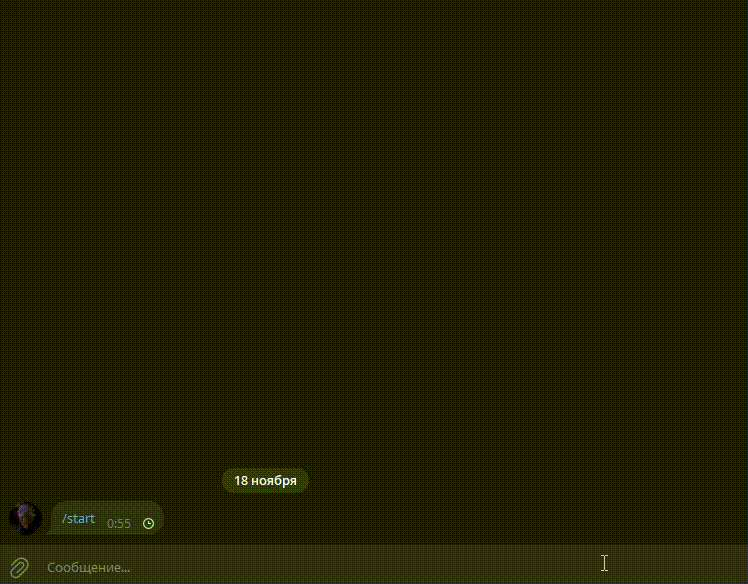
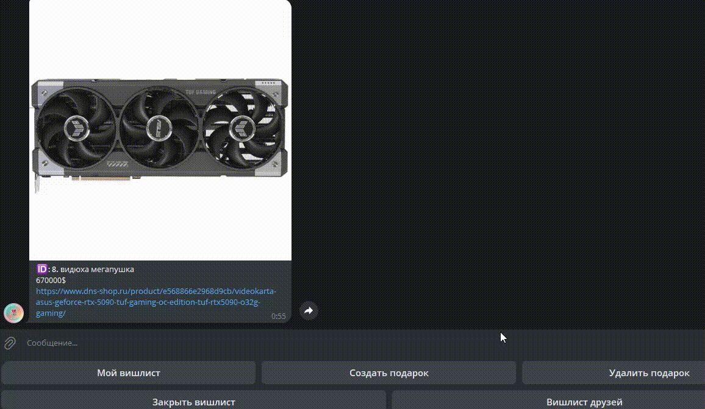
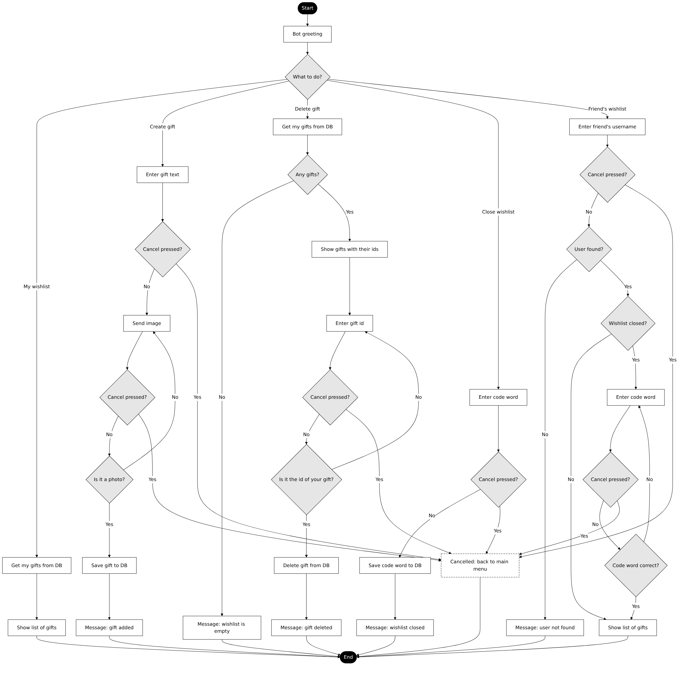

<h1>Wishlist Bot✨</h1>

<h3>Description</h3>

This bot was created so that everyone can leave their gift wishes in it and share them with their friends!

What distinguishes it from analogs is that the bot works entirely through messages in the messenger itself, without using a mini-app, which makes it easier to use.

<h3>Features</h3>
<ul>
  <li>Create and view your own wishlist of gifts</li>
  <li>View a friend's wishlist by username</li>
  <li>Add new gifts (text + image)</li>
  <li>Delete gifts from your wishlist</li>
  <li>Close your wishlist with a code word (for privacy)</li>
  <li>Works entirely through regular messages in Telegram (without mini-app)</li>
</ul>

<h3>Video Demo</h3>

Watch the bot interface and in action:

<h3>How it works</h3>

To understand how the bot works, I created something like an activity diagram.

The flowchart above shows the main user scenarios of the bot. It was created to illustrate how the bot handles user actions: viewing wishlists, creating gifts, closing wishlists, and deleting gifts.

<h3>Environment requirements</h3>
<table>
  <tr>
    <td><b>Python</b></td>
    <td>v3.13</td>
  </tr>
  <tr>
    <td><b>Database</b></td>
    <td>PostgreSQL v18.6</td>
  </tr>
  <tr>
    <td><b>Python libraries</b></td>
    <td><code>python-telegram-bot==22.5</code>, <code>psycopg2</code></td>
  </tr>
  <tr>
    <td><b>Telegram</b></td>
    <td>Bot Token from @BotFather</td>
  </tr>
  <tr>
    <td><b>Database access</b></td>
    <td>Access to a PostgreSQL instance (database name, user, password, host, port)</td>
  </tr>
</table>

<h3>Installation</h3>
<ol>
  <li>Clone the repository:
    <pre><code>git clone https://github.com/Dunwitch666/Wish-list-telegram-bot.git</code></pre>
    <pre><code>cd Wish-list-telegram-bot</code></pre>
  </li>
  <li>Install Python 3.13.</li>
  <li>Install dependencies:
    <pre><code>pip install python-telegram-bo psycopg2-binary python-dotenv</code></pre>
  </li>
  <li>Set up PostgreSQL and create a database for the bot.</li>
  <li>Configure environment variables in the .env document: bot token (<code>BOT_TOKEN</code>) and database connection parameters.</li>
  <li>Run the bot:
    <pre><code>python main.py</code></pre>
  </li>
</ol>

<h3>Stack</h3>
<ul>
  <li>python v3.13</li>
  <li>python-telegram-bot v22.5</li>
  <li>postgreSQL v18.6</li>
  <li>psycopg2</li>
</ul>