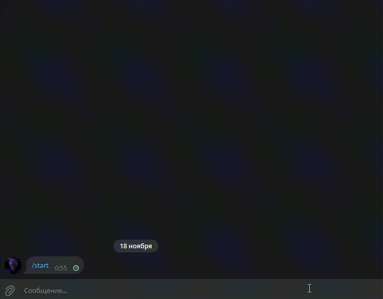
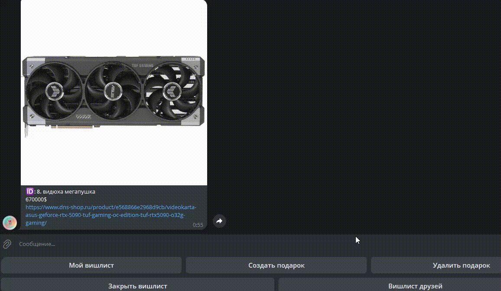
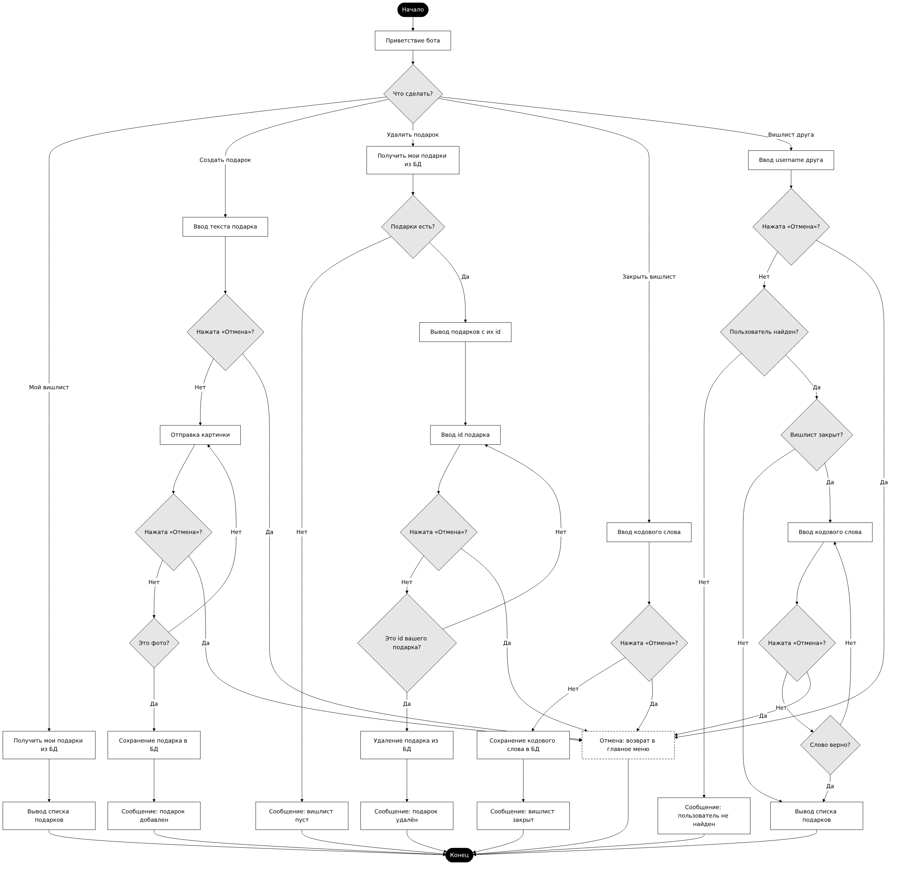

<h1>Бот желаний✨</h1>

<h3>Описание</h3>

Бот создан для того, чтобы каждый мог оставить в нем свои пожелания по поводу подарка и поделиться ими со своими друзьями!

Отличительной чертой от аналогов можно считать то, что бот работает полностью через сообщения в самом мессенджере, а не использует mini-app что делает его более простым в использовании.

<h3>Возможности</h3>
<ul>
  <li>Создание и просмотр собственного вишлиста подарков</li>
  <li>Просмотр вишлиста друга по username</li>
  <li>Добавление новых подарков (текст + изображение)</li>
  <li>Удаление подарков из своего вишлиста</li>
  <li>Закрытие вишлиста кодовым словом (для приватности)</li>
  <li>Работа полностью через обычные сообщения в Telegram (без mini-app)</li>
</ul>

<h3>Видеодемонстрация</h3>

Посмотрите работу бота и интерфейс в действии:

<h3>Принцип работы</h3>

Для понимания работы бота я составил подобие диаграммы деятельности

Диаграмма выше показывает основные сценарии работы бота. Она создана для иллюстрации того, как бот обрабатывает действия пользователя: просмотр вишлистов, создание подарков, закрытие вишлистов и удаление подарков.

<h3>Требования к окружению</h3>
<table>
  <tr>
    <td><b>Python</b></td>
    <td>v3.13</td>
  </tr>
  <tr>
    <td><b>База данных</b></td>
    <td>PostgreSQL v18.6</td>
  </tr>
  <tr>
    <td><b>Библиотеки Python</b></td>
    <td><code>python-telegram-bot==22.5</code>, <code>psycopg2</code></td>
  </tr>
  <tr>
    <td><b>Telegram</b></td>
    <td>Токен бота от @BotFather</td>
  </tr>
  <tr>
    <td><b>Доступ к базе данных</b></td>
    <td>Доступ к экземпляру PostgreSQL (имя БД, пользователь, пароль, хост, порт)</td>
  </tr>
</table>

<h3>Установка</h3>
<ol>
  <li>Клонируйте репозиторий:
    <pre><code>git clone https://github.com/Dunwitch666/Wish-list-telegram-bot.git</code></pre>
    <pre><code>cd Wish-list-telegram-bot</code></pre>
  </li>
  <li>Установите Python 3.13.</li>
  <li>Установите зависимости:
    <pre><code>pip install python-telegram-bot==22.5 psycopg2-binary</code></pre>
  </li>
  <li>Разверните PostgreSQL и создайте базу данных для бота.</li>
  <li>Настройте переменные окружения в .env файле: токен бота (<code>BOT_TOKEN</code>) и параметры подключения к БД.</li>
  <li>Запустите бота:
    <pre><code>python main.py</code></pre>
  </li>
</ol>

<h3>Стек</h3>
<ul>
  <li>python v3.13</li>
  <li>python telegram bot v22.5</li>
  <li>postgresSQL v18.6</li>
  <li>psycopg2</li>
</ul>
